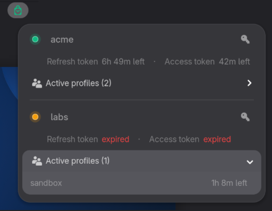

# Auth Monitor

Manage authentication sessions from the GNOME Shell top bar.  
Currently supports AWS SSO.



## Features

- Lists every `[sso-session]` entry from `~/.aws/config`
- Each SSO session gets:
    - A status indicator.
    - Expiration time for every active AWS profile.
    - Expiration time for the access token (used to activate AWS profile sessions).
    - Expiration time for the refresh token (used to mint new access tokens).
    - One-click `aws sso login`

## Installation

### From GitHub releases

1. Download the latest `.zip` from [Releases](https://github.com/ramikg/gnome-auth-monitor/releases).
2. Run:
    ```bash
    gnome-extensions install --force auth-monitor@ramikg.zip
    ```

_Requirements: GNOME 46+, AWS CLI v2 (`aws` on `$PATH`)_

### From source code

```bash
make install
```

_Additional requirement: Node.js_

### Post-installation

To enable the extension after installation:

1. Log out and back in (or reboot).
2. Run:
    ```bash
    gnome-extensions enable auth-monitor@ramikg
    ```
